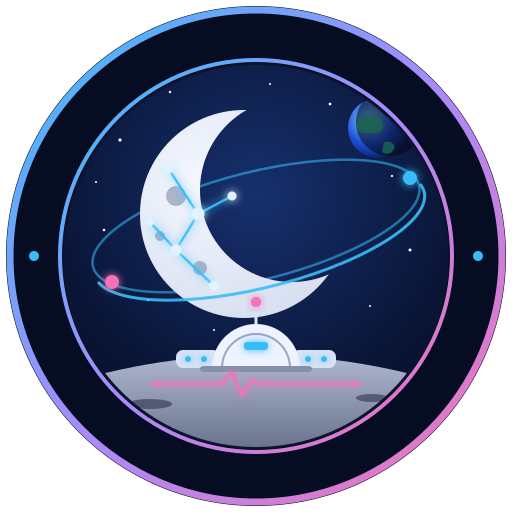

<div align="center">



# LUNA-X AI

**Lunar Adaptive Neural Assistant: the AI operating system for the Project ARES lunar habitat.**
A NASA HUNCH student project. It works beside **[SELENE](https://jaigod.github.io/lunar-crew-monitor/)**, the crew health AI.

**[▶ Open LUNA-X AI](https://jaigod.github.io/LUNA-AI/)** · [Main project site](https://jaigod.github.io/LunarSmartAdaptiveHabitat/) · [SELENE](https://github.com/JaiGod/lunar-crew-monitor)

</div>

## LUNA and SELENE

| | Role | What it does |
|---|---|---|
| **SELENE** | Perception | Measures the crew (vitals, sleep, hydration, exercise, radiation, brainwaves, mood, face and voice check-ins) and runs **SELENE Vision**, which recognises objects in the camera feed. |
| **LUNA-X** | Command | Decides and acts: habitat systems, crew support, mission planning, resources, predictive maintenance, emergencies, network defence. It asks SELENE whenever health matters. |

LUNA-X is not a single AI. It is an **orchestrator**: it sends each task to the connected model best suited to it, then fuses their answers.

| Task | Routed to |
|---|---|
| Reasoning, habitat tools, safety review, crew support | **Claude** (Anthropic) |
| SELENE deep scan: geology, crew, equipment, hazards | **Claude** vision, structured JSON |
| Independent check of each detection | **Gemini**, **OpenAI**, **Meta Llama** (OpenRouter), **Groq** |
| Live object detection on every frame | **COCO-SSD** in the browser (free, on device) |
| Conversation with no Claude key | Any connected free AI: Gemini free tier, Llama via OpenRouter or Groq, Chrome's built-in Gemini Nano, or WebLLM |
| Commands with no AI at all | LUNA's offline brain (rules), the same tools |

## Every AI feature from the Project ARES sims, in one place

| Sim | Feature in LUNA-X |
|---|---|
| SIM-01/02/03 Habitat, Commander, LUNA | 9 habitat sensors, 9 rooms, NASA limits, three response tiers (silent change → offer they can refuse → human), forecasts days ahead, solar storms and lunar night, autopilot that reacts to new alerts |
| SIM-04 LUNA VR | Wellness Dock: ISS-style reaction test, crew-wide breaks, EVA readiness check (suit, exterior, reaction time), messages home with the 1.3 s light delay |
| SIM-05 Astronaut Voice Log | “start log” / “stop log”; mood (8 moods) from your words **and** your voice's pitch, range and loudness compared with your calm baseline |
| SIM-06 Luna Companion | Camera face check-in, jokes, messages from Earth. Repeated low moods: LUNA asks before telling the psychologist. Crisis words reach a human at once |
| SIM-07 SELENE | Vitals, HRV, SpO₂, sleep, hydration, exercise and resistive minutes, radiation dose against the 600 mSv career limit, EEG state, circadian lighting (6500 K → 1900 K), soundscapes, space music, 4-7-8 breathing, consent controls, learns what helps each person |
| SIM-08 Workout Coach | 8 exercises, rep counting, camera form checks with cues (“chest up”), personal bests, badges, and a message from Earth after each workout |
| SIM-09 Training Hub | Rate every answer, correct LUNA (she stores corrections and checks them first), 7 emergency drills scored by the crew, six skill areas, photo panel inspection for predictive maintenance |
| SIM-10 LASH-Net | Six network attacks (rogue login, malware, rover hijack, DoS from Earth, fake sensor data, AI breach). LUNA reads the logs and isolates, blocks or quarantines; life support stays on its own locked segment |
| New: SELENE Vision | Recognises space classes instead of Earth objects (basalt, anorthosite, regolith, ice, ore, crew, EVA personnel, oxygen tanks, rovers, tools, structural damage, leaks…). Shows holographic boxes, confidence, distance, risk, resource value, and a LUNA-X decision card |

Safety is built in. Crisis and medical-emergency words are caught **on the device, before anything is sent to an AI**, and raise a red alert. The page always says the demo is simulated and shows real crisis lines (988 in the US).

## Connecting AI (and what's free)

Open **Connect AI** (the AI Network tab):

| Provider | Cost | Key |
|---|---|---|
| Claude | Paid (no free API tier) | [console.anthropic.com](https://console.anthropic.com/settings/keys), or the proxy below |
| Gemini | **Free tier** | [aistudio.google.com/apikey](https://aistudio.google.com/apikey) |
| Meta Llama via OpenRouter | **Free models** (`:free`) | [openrouter.ai/keys](https://openrouter.ai/keys) |
| Groq (Llama) | **Free tier** | [console.groq.com/keys](https://console.groq.com/keys) |
| Gemini Nano (Chrome built-in) | **Free, no key**, on device | recent desktop Chrome |
| WebLLM (Llama in your browser) | **Free, no key**, on device | needs WebGPU; downloads ~1 GB once |
| OpenAI | Paid | [platform.openai.com](https://platform.openai.com/api-keys) |

Model names are editable, because providers rename models over time.

Keys stay in your browser, and each key is sent only to its own provider. They are kept between visits only if you tick “Remember”. Anyone using the same computer could copy a key from the page, so use keys with spending limits.

### Optional: keep the Claude key off the page

`worker/` holds a Cloudflare Worker proxy that stores the key as a secret and only serves this site:

```bash
cd worker
npx wrangler deploy
npx wrangler secret put ANTHROPIC_API_KEY
```

Then paste the Worker URL into **Claude → proxy URL**. Anyone who visits the site can then use LUNA-X on your key, so set a monthly spend limit in the Claude Console.

## How it's built

- Plain HTML plus JavaScript modules, bundled with esbuild into `dist/luna.js` (run `npm install` then `npm run build`). It's hosted on GitHub Pages and needs no server.
- Claude is called through the official `@anthropic-ai/sdk`. LUNA's tools are client-side functions that run against the habitat simulation, and every tool input is validated before it runs. Responses stream, and the conversation history only ever grows, so prompt caching keeps working.
- The default model is Claude Opus 5.5 with adaptive thinking and server-side refusal fallback; Sonnet 5.5 and Haiku 5.5 can be chosen.
- `src/sim.js` holds the habitat, crew, network and learning models. `src/tools.js` holds the 14 tools, `src/brain.js` the Claude loop and offline brain, `src/vision.js` SELENE Vision and the senses, `src/orchestrator.js` the multi-model routing and fusion, and `src/core.js` the cognitive core visual.

## Limits

This is a research and education prototype, not a medical device, and it never diagnoses. All crew, habitat and network data is simulated. Mood, fatigue and rock types estimated from a camera are estimates. Video and audio are only sent to an AI when you press a scan or check-in button, and they are never stored.
