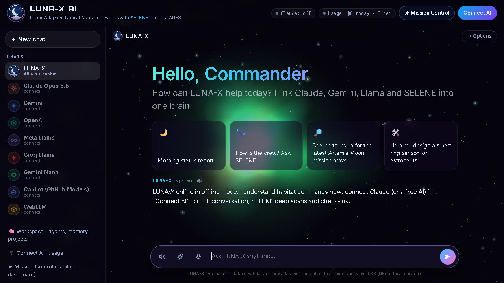

<div align="center">


# LUNA-X AI

**Lunar Adaptive Neural Assistant: the AI operating system for the Project ARES lunar habitat.**
A NASA HUNCH student project by Jaineil R., Angel C. and Farhan K. It works beside **[SELENE](https://jaigod.github.io/lunar-crew-monitor/)**, the crew health AI.

**[▶ Open LUNA-X AI](https://jaigod.github.io/LUNA-AI/)** · [Main project site](https://jaigod.github.io/LunarSmartAdaptiveHabitat/) · [SELENE](https://github.com/JaiGod/lunar-crew-monitor)



</div>

## What it is

LUNA-X links several AI systems into one brain for a simulated four-person lunar base. **SELENE senses** the crew (vitals, sleep, mood, radiation, camera check-ins) and **LUNA-X decides and acts** (habitat systems, crew support, mission planning, emergencies, network defence). LUNA-X asks SELENE whenever health matters.

It is not one AI but an **orchestrator**: each task goes to the connected model best suited to it, and the answers are fused. With no AI key at all it still runs habitat commands, drills and network defence offline.

The look is based on the star projector that inspired the project: a glowing burst of light that slowly turns and shifts from red to green, cyan and blue over a field of teal stars.

## Two views

| View | What you get |
|---|---|
| **Chat view** (default) | A clean chat app. The sidebar has a **LUNA-X chat** (every AI plus the habitat) and a **separate chat for each AI** (Claude, Gemini, Llama, OpenAI, Copilot, Gemini Nano, WebLLM), so you can talk to one AI directly without the LUNA persona. |
| **Mission Control** | The habitat dashboard: the animated **cognitive core**, habitat sensors and rooms, crew and SELENE, SELENE Vision, check-ins, Wellness Dock, Training, LASH-Net network defence, Workspace and the AI Network. |

## What LUNA-X can do

- **Anything Claude can do with an API key:** answer questions on any subject, write, explain, tutor, do maths, and write and debug code. It **searches the web**, **reads web pages** and **runs Python code** (Claude's server tools), and cites its sources.
- **Read your files:** attach images, PDFs and text or code files (button, paste or drag and drop).
- **Habitat tools:** 17 tools that read sensors, ask SELENE, adjust rooms, make offers the crew can refuse, escalate to humans, schedule, forecast, check EVA readiness, run drills, defend the network, read the camera and update memory.
- **Workspace:** specialist **Luna agents** (Engineer, Researcher, Designer, Marketing), **long-term memory** of your projects and preferences, **project notes** LUNA can continue from, and **auto-routing** of each task to the best connected AI.
- **SELENE Vision:** the camera recognises space classes instead of Earth objects (basalt, anorthosite, regolith, ice, crew, tools, oxygen tanks, rovers, damage, leaks…) with holographic boxes, distance, risk and resource value. A deep scan uses Claude, and every connected AI can vote on each detection.
- **Voice:** LUNA reads replies aloud (choose the voice and speed), listens with push-to-talk or "Hey Luna", and keeps a voice log with mood from your words and voice.
- **Who is in control:** LUNA-X with Claude as its brain, **Claude takes over** (LUNA switched off), or **LUNA solo** (Claude on standby).
- **Super-brain charge:** the core glows brighter and charges up with every AI and server connection. Connected AIs appear as linked icons beside the logo (LINKED, DUAL LINK, TRIPLE LINK…).
- **Usage meter:** requests, tokens, web searches and estimated cost for each AI, today and in total, with links to each provider's official dashboard.

Every AI feature from the Project ARES sims is here too:

| Sim | Feature in LUNA-X |
|---|---|
| SIM-01/02/03 Habitat, Commander, LUNA | 9 sensors, 9 rooms, NASA limits, three response tiers (quiet change → offer they can refuse → human), forecasts, solar storms, lunar night, autopilot |
| SIM-04 LUNA VR | Wellness Dock: ISS-style reaction test, crew breaks, EVA readiness, messages home with the 1.3 s light delay |
| SIM-05 Astronaut Voice Log | "start log" / "stop log"; mood from your words and your voice compared with your calm baseline |
| SIM-06 Luna Companion | Camera face check-in, jokes, messages from Earth; asks before telling the psychologist |
| SIM-07 SELENE | Vitals, HRV, SpO₂, sleep, hydration, exercise, radiation against the 600 mSv career limit, brainwaves, circadian lighting, soundscapes, breathing, consent |
| SIM-08 Workout Coach | Rep counting, camera form checks, personal bests, badges |
| SIM-09 Training Hub | Rate answers, correct LUNA (she remembers), 7 drills scored by the crew, six skill areas, panel inspection |
| SIM-10 LASH-Net | Six network attacks; LUNA isolates, blocks or quarantines while life support stays on its own segment |

## Safety

- Crisis and medical-emergency words are caught **on the device, before anything is sent to an AI**, and raise a red alert with real crisis lines (988 in the US).
- Camera frames and audio go to an AI only when you press a scan or check-in button, and they are never stored.
- It is a research and education prototype, not a medical device, and it never diagnoses. All crew, habitat and network data is simulated.

## Connecting AI (and what's free)

Open **Connect AI**. A key is checked as you paste it, and the link is tested automatically.

| Provider | Cost | Key |
|---|---|---|
| Claude | Paid (no free API tier) | [console.anthropic.com](https://console.anthropic.com/settings/keys), or the proxy below |
| Gemini | **Free tier**, with Google Search | [aistudio.google.com/apikey](https://aistudio.google.com/apikey) |
| Meta Llama via OpenRouter | **Free models** (`:free`) | [openrouter.ai/keys](https://openrouter.ai/keys) |
| Groq (Llama) | **Free tier** | [console.groq.com/keys](https://console.groq.com/keys) |
| Copilot (GitHub Models) | **Free** with a GitHub token; needs the proxy (GitHub blocks browser calls) | [github.com/settings/personal-access-tokens](https://github.com/settings/personal-access-tokens) |
| Gemini Nano (Chrome built-in) | **Free, no key**, on device | recent desktop Chrome |
| WebLLM (Llama in your browser) | **Free, no key**, on device | needs WebGPU; downloads ~1 GB once |
| OpenAI | Paid | [platform.openai.com](https://platform.openai.com/api-keys) |

Keys stay in your browser and each key goes only to its own provider. Tick **Remember** to keep a key after a refresh; it then also works in SELENE, which shares the connection. Anyone using the same computer could copy a key from the page, so use keys with spending limits. Claude's web search costs about $10 per 1,000 searches on your key.

### Optional: the LUNA proxy (keeps the Claude key off the page, enables Copilot)

`worker/` holds a Cloudflare Worker that stores the Claude key as a secret, only serves this site, and forwards Copilot (GitHub Models) calls:

```bash
cd worker
npx wrangler deploy
npx wrangler secret put ANTHROPIC_API_KEY
```

Then paste the Worker URL into **Claude → proxy URL**, and for Copilot set the API base URL to `https://<your-worker>.workers.dev/github`. Anyone who visits the site can then use LUNA-X on your key, so set a monthly spend limit in the Claude Console.

## How it's built

- Plain HTML and JavaScript modules, bundled with esbuild into `dist/luna.js` (`npm install`, then `npm run build`). Hosted on GitHub Pages; no server needed.
- Claude is called through the official `@anthropic-ai/sdk` with streaming, adaptive thinking and server-side refusal fallback. Every habitat tool input is validated before it runs, and the conversation history only grows, so prompt caching keeps working. Default model: Claude Opus 5.5 (Sonnet 5.5 and Haiku 5.5 can be chosen).
- Animations use transforms and opacity only, run at about 60 fps, and switch off when your system asks for reduced motion.

| File | What it holds |
|---|---|
| `src/sim.js` | Habitat, crew, network and learning simulation |
| `src/tools.js` | The habitat tools and their validation |
| `src/brain.js` | Claude loop, direct Claude chat, offline brain, crisis check |
| `src/orchestrator.js` | Providers, routing, multi-model fusion |
| `src/vision.js` | SELENE Vision and the camera and voice senses |
| `src/chatview.js` | Chat view and the separate AI chats |
| `src/workspace.js` | Agents, memory, projects, auto-routing |
| `src/usage.js` | Usage meter |
| `src/core.js` | The cognitive core and its charge |
| `src/nebula.js` | The projector sky, shooting stars and parallax |
| `src/fx.js` | Micro-interactions (ripples, tilt, glow, tab indicator, count-up) |
| `src/md.js` | Safe Markdown rendering of replies |
| `worker/` | Optional Cloudflare proxy |
